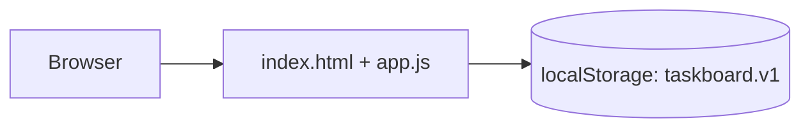

# Technical assessment — TaskBoard (sample)

## 01 Architecture

A static single-page app: `app/index.html` plus one script, `app/app.js`, served as files. There is no server code and no database. All state (user, tasks, categories, settings) is one JSON object in the browser's localStorage under `taskboard.v1`.

## 02 Code health

| Measure | Result |
|---|---|
| Size | 109 lines of JavaScript, 74 of HTML |
| Complexity | no function above complexity 15 (lizard) |
| Tests | 28 test cases across Playwright, Cypress and Selenium; every journey proven |
| Accessibility | no serious or critical violations |

## 03 Security design

- Output is escaped before it is inserted into the page (`escape`, app/app.js:54-56).
- Roles and permissions exist only in the browser; see T-02 and T-03.
